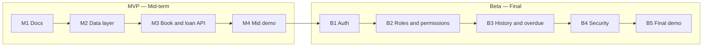

# Product Requirements Document (PRD) — LibTrack

| Field | Value |
|---|---|
| Product | LibTrack — Library Management System |
| Version | MVP + Beta |
| Releases | MVP — Mid-term, Beta — Final |
| Status | Draft |
| Related docs | [Software Requirements Specification (SRS)](02-srs.md), [Technical Design Document (TDD)](03-tdd.md) |

This document covers **both releases**. Every goal, feature and story has a **Release** column so it is clear what is built for the mid-term and what is added for the final.

## Documents in this set

| Short form | Full form | Purpose | File |
|---|---|---|---|
| PRD | Product Requirements Document | What we build and why (this document) | [01-prd.md](01-prd.md) |
| SRS | Software Requirements Specification | Exact requirements, permissions and acceptance criteria | [02-srs.md](02-srs.md) |
| TDD | Technical Design Document | How we build it: architecture, data model, API | [03-tdd.md](03-tdd.md) |

## 0. Release plan

| Release | When | Focus |
|---|---|---|
| **MVP** | Mid-term | Core product: book CRUD, book search/listing, borrowing and return records, database, deployed on Vercel |
| **Beta** | Final | Accounts and login, role-based access control (Admin, Librarian, Student), borrowing history, overdue tracking, security hardening |

## 1. Purpose

LibTrack is a library management system for organizing books and tracking borrowing and returns. It is developed in two clear steps:

1. **MVP (mid-term):** a small, working REST API for managing books and recording basic borrowing and return transactions, backed by a database and deployed on Vercel.
2. **Beta (final):** turn the MVP into a multi-user system with accounts, three roles (Admin, Librarian, Student), role-based permissions, student borrowing history, and overdue-book tracking.

## 2. Problem statement

Libraries need a reliable way to keep book records up to date and track which books are available, borrowed, returned, or overdue. Without a central system, librarians may find it difficult to manage book inventories and loan records, while students may not know which books are available or what they have borrowed. LibTrack provides one place to manage these records and applies permissions so each role can perform only its allowed actions.

## 3. Goals

| ID | Goal | Release |
|---|---|---|
| G-1 | Provide a REST API for creating, reading, updating and deleting book records. | MVP |
| G-2 | Store books and borrowing records in a database so data survives restarts and redeploys. | MVP |
| G-3 | Record book borrowing and returns, and update availability consistently. | MVP |
| G-4 | Document the API automatically (OpenAPI at `/api/docs`). | MVP |
| G-5 | Deploy automatically to Vercel on every push to `main`. | MVP |
| G-6 | Provide accounts and login for Admin, Librarian and Student users. | Beta |
| G-7 | Enforce role-based access control (RBAC) on every protected operation. | Beta |
| G-8 | Let students search books and view their own borrowing history. | Beta |
| G-9 | Identify overdue loans using due dates and return status. | Beta |
| G-10 | Protect accounts and library data with secure authentication and validation. | Beta |

## 4. Target users

| User | Need | Release |
|---|---|---|
| Librarian / demo user | Add, view, edit and remove book records; record borrowing and returns. | MVP |
| Frontend developer | A clear, documented API to build the UI on. | MVP |
| Instructor / reviewer | An easy way to try the API (`/api/docs`) and check the code. | MVP |
| Student | Search the catalogue, check availability, and view their own current and past loans. | Beta |
| Librarian | Manage book inventory, issue books, record returns, and review overdue loans. | Beta |
| Admin | Manage accounts, assign roles, and configure basic system settings. | Beta |

During the **MVP**, the API is a small demonstration system and does not enforce user accounts or role-specific permissions. In the **Beta**, each account has a role and loan records are linked to the student who borrowed the book.

## 5. Scope

### In scope — MVP (mid-term)

- Create, list (with pagination), view, update and delete book records
- Store core book information: title, author, ISBN (optional), publication year (optional), and total copies
- Search/filter the catalogue by title or author
- Record a book loan with a student identifier and due date
- Record a return and update available-copy counts
- Input validation and clear error responses
- Health check endpoint
- Interactive API docs at `/api/docs`
- Automatic deploy to Vercel

### In scope — Beta (final)

- **Auth:** sign up or admin-created accounts, log in, log out, refresh session (JWT access token + refresh token)
- **User profile:** view basic profile details and change password
- **Roles / RBAC:** `admin`, `librarian`, and `student`; enforce permissions on every protected endpoint
- **Admin:** manage accounts, activate/deactivate accounts, assign roles, and manage basic system settings
- **Book catalogue:** librarians can add, edit, and remove books; students can search and view book details and availability
- **Borrowing:** librarians issue available books to students and record returns
- **Loan rules:** each loan has a borrow date, due date, and optional return date; prevent borrowing when no copy is available
- **Student history:** students can view only their own current and past borrowing records
- **Overdue tracking:** list loans past their due date that have not been returned; show overdue status
- **Security:** hashed passwords, secure session handling, login attempt limit, security headers, secrets only in environment variables

### Out of scope for this semester

- Online payments, fines payment, and payment gateway integration
- Email/SMS reminders and push notifications
- Barcode/RFID scanner integration
- Inter-library loans and multiple library branches
- Book reservations and waitlists
- E-book hosting or digital rights management
- Recommendation engine, advanced analytics, and reading statistics
- Social login, email verification, and password reset workflow
- Native mobile application

## 6. Features and priority (MoSCoW)

Priorities are per release: a Beta "Must" is required for the final, not for the mid-term.

| ID | Feature | Release | Priority |
|---|---|---|---|
| F-1 | Create book record | MVP | Must |
| F-2 | List and view book records | MVP | Must |
| F-3 | Update book record | MVP | Must |
| F-4 | Delete book record when safe to do so | MVP | Must |
| F-5 | Search/filter books by title or author | MVP | Should |
| F-6 | Record a borrowing transaction | MVP | Must |
| F-7 | Record a book return and update availability | MVP | Must |
| F-8 | Validation and error responses | MVP | Must |
| F-9 | Health check | MVP | Must |
| F-10 | Pagination on book list (`offset`, `limit`) | MVP | Should |
| F-11 | Simple React page that uses the API | MVP | Could |
| F-12 | Sign up/account creation, log in, log out, refresh session | Beta | Must |
| F-13 | Roles `admin`, `librarian`, `student` with permission checks | Beta | Must |
| F-14 | Admin: manage accounts, roles and basic settings | Beta | Must |
| F-15 | Librarian: add, edit and remove book records | Beta | Must |
| F-16 | Librarian: issue books and record returns | Beta | Must |
| F-17 | Student: search catalogue and view book availability | Beta | Must |
| F-18 | Student: view own borrowing history | Beta | Must |
| F-19 | Overdue loan detection and overdue list | Beta | Must |
| F-20 | Security hardening (password hashing, session security, login limit, headers) | Beta | Must |
| F-21 | React pages for login, catalogue, loans and role-specific dashboards | Beta | Could |
| F-22 | Admin overview with counts of books, active loans and overdue loans | Beta | Should |
| F-23 | User profile: view details and change password | Beta | Should |

## 7. User stories

### MVP

| ID | Story | Feature |
|---|---|---|
| US-01 | As a librarian/demo user, I want to add a book with its details, so the catalogue stays up to date. | F-1 |
| US-02 | As a user, I want to see the book catalogue, so I can know which books are recorded. | F-2, F-10 |
| US-03 | As a user, I want to open one book record, so I can see its details and availability. | F-2 |
| US-04 | As a librarian/demo user, I want to edit a book record, so I can correct or update its information. | F-3 |
| US-05 | As a librarian/demo user, I want to remove a book record when it has no active loans, so the catalogue stays accurate. | F-4 |
| US-06 | As a user, I want to search by title or author, so I can find a book more easily. | F-5 |
| US-07 | As a librarian/demo user, I want to record a book loan with a due date, so I know who borrowed it and when it is due. | F-6 |
| US-08 | As a librarian/demo user, I want to record a return, so the book becomes available again. | F-7 |
| US-09 | As a client developer, I want clear validation errors, so I know what went wrong. | F-8 |
| US-10 | As a maintainer, I want a health endpoint, so I can check the deployment is running. | F-9 |

### Beta

| ID | Story | Feature |
|---|---|---|
| US-11 | As a visitor, I want to sign in or have an account created, so I can use LibTrack with the correct role. | F-12 |
| US-12 | As a user, I want to log in and log out, so only I can use my account. | F-12 |
| US-13 | As an admin, I want to create, deactivate and manage accounts, so I can control system access. | F-14 |
| US-14 | As an admin, I want to assign the Admin, Librarian or Student role, so each account has the correct permissions. | F-13, F-14 |
| US-15 | As a librarian, I want to add, edit and remove book records, so the catalogue is accurate. | F-15 |
| US-16 | As a librarian, I want to issue an available book to a student, so the loan is recorded correctly. | F-16 |
| US-17 | As a librarian, I want to record a return, so the loan is closed and the book becomes available. | F-16 |
| US-18 | As a student, I want to search books and see availability, so I can find a book to borrow. | F-17 |
| US-19 | As a student, I want to view my own borrowing history, so I can track current and previous loans. | F-18 |
| US-20 | As a librarian, I want to see overdue loans, so I can follow up on books that have not been returned on time. | F-19 |
| US-21 | As a user, I want my password stored safely and repeated wrong logins limited, so my account is better protected. | F-20 |
| US-22 | As an admin, I want an overview of books, active loans and overdue loans, so I can understand the library's current status. | F-22 |
| US-23 | As a user, I want to view my profile and change my password, so I can maintain my account. | F-23 |

## 8. Success metrics

### MVP

- Book create, list, detail, update and delete endpoints work on the production Vercel URL.
- Borrowing and return endpoints correctly create/update loan records and available-copy counts.
- Data remains available after a redeploy.
- `/api/docs` lists every endpoint with request and response schemas.
- Invalid requests return clear error responses without corrupting book or loan data.

### Beta

- Admin, Librarian and Student permissions are enforced on every protected endpoint.
- Students can never view another student's borrowing history.
- Students cannot create or edit book records or mark their own books as returned.
- Librarians can issue only available copies and can record valid returns.
- A returned loan is no longer considered overdue.
- Overdue status is based on the due date and the absence of a return date.
- Passwords are never stored or returned in plain text.
- Deactivated accounts cannot log in or use protected API endpoints.

## 9. Assumptions and constraints

- Hosted on Vercel (frontend and FastAPI backend in one project, see `vercel.json`).
- Backend: Python 3.10+, FastAPI. Frontend: Vite + React + TypeScript.
- Database: Supabase PostgreSQL; library and loan data must not depend on a local file because Vercel functions are serverless.
- Core entities are users, books and loans; a loan connects one student to one book and stores borrow date, due date and return date.
- The first Admin account is promoted manually in the database; after that, admins manage accounts and roles through the API.
- The MVP is a demonstration release and does not yet enforce authentication or role-based permissions.
- A book record stores the total number of copies and the number available; borrowing and returning must update availability consistently.
- Book records with active loans cannot be permanently deleted; they should be rejected with a clear error or marked inactive.

## 10. Milestones

### MVP — Mid-term

| Milestone | Deliverable |
|---|---|
| M1 — Docs | [PRD](01-prd.md), [SRS](02-srs.md) and [TDD](03-tdd.md) (covering MVP and Beta) approved |
| M2 — Data layer | Book and loan models plus database connection |
| M3 — API | Book CRUD endpoints, search/list endpoint, borrowing and return endpoints with validation |
| M4 — Mid demo | Live on Vercel, tagged `v0.1.0` (MVP) |

### Beta — Final

| Milestone | Deliverable |
|---|---|
| B1 — Auth | Account creation/login/logout/refresh and user profile; loan records linked to student accounts; database migrations in place |
| B2 — RBAC + admin | Admin, Librarian and Student roles; account management; permission checks on every protected endpoint |
| B3 — Library workflows | Catalogue search, issue/return workflow, student borrowing history, overdue list |
| B4 — Security | Password hashing, secure session handling, login attempt limit, security headers, secret review |
| B5 — Final demo | Beta live on Vercel, tagged `v0.2.0` (Beta) |

## 11. Release dependencies

- The Beta is built on top of the MVP: the same book and loan endpoints remain, but in the Beta they require authentication and enforce role-based permissions.
- Database migrations are introduced at the start of the Beta so the schema can grow from the MVP's book and loan tables to include users and role-specific relationships without manual SQL.
- Borrowing and return logic must be consistent before authentication is added, because the Beta reuses the same library workflows.
