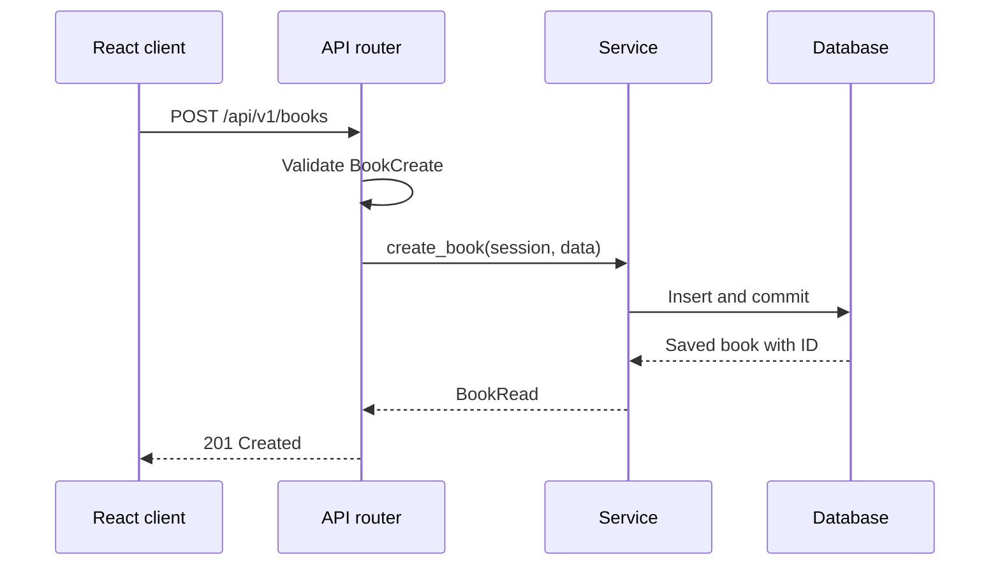
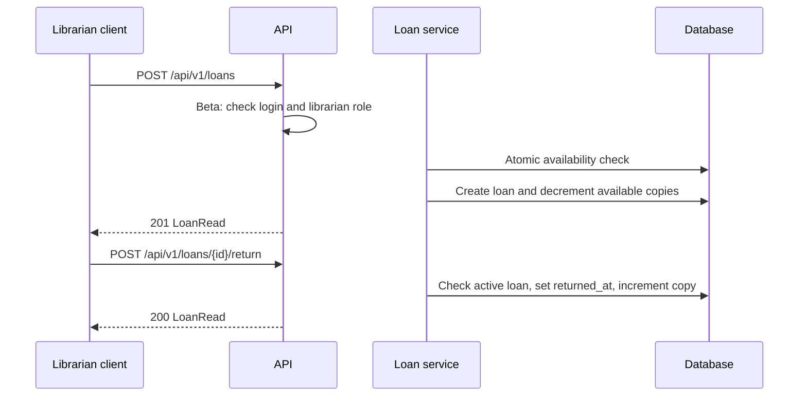
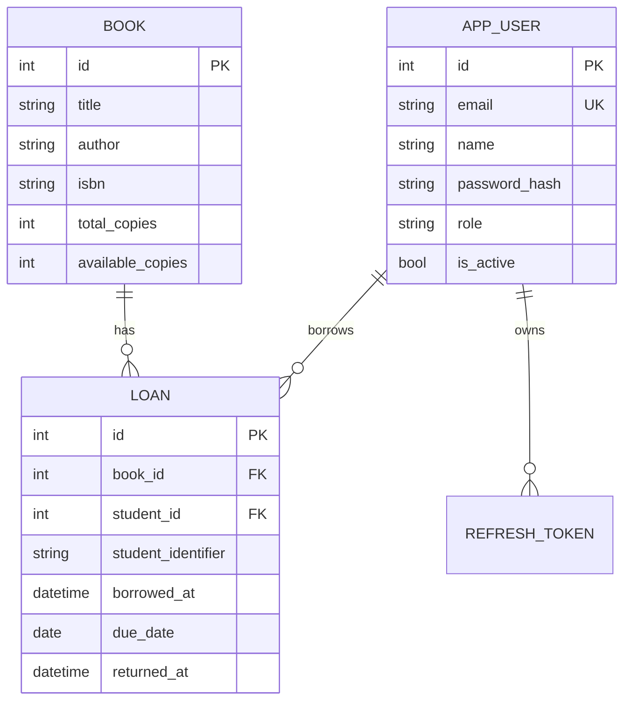
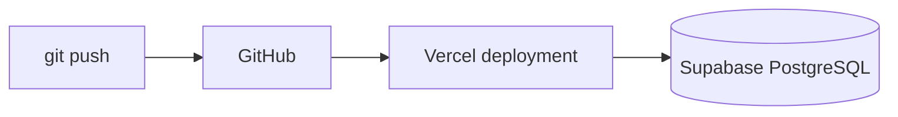

# Technical Design Document (TDD) — LibTrack

| Field | Value |
|---|---|
| Product | LibTrack — Library Management System |
| Version | MVP + Beta |
| Releases | MVP — Mid-term, Beta — Final |
| Status | Draft |
| Related docs | [PRD](01-prd.md), [SRS](02-srs.md) |

Sections marked **MVP** are for midterm; **Beta** extends the app for the final.

## Documents in this set
| Short form | Purpose | File |
|---|---|---|
| PRD | What we build and why | [01-prd.md](01-prd.md) |
| SRS | Requirements and acceptance criteria | [02-srs.md](02-srs.md) |
| TDD | Architecture, data model and API | [03-tdd.md](03-tdd.md) |

## 1. Overview
- **MVP:** FastAPI REST API for book CRUD, search, borrowing and returns, backed by SQLModel and a persistent database.
- **Beta:** login, Admin/Librarian/Student roles, account management, student history and overdue tracking.
- **Frontend:** Vite + React + TypeScript.
- **Production:** Vercel for the app and Supabase PostgreSQL for persistent data.

## 2. Tech stack
| Layer | Choice | Why | Release |
|---|---|---|---|
| API | FastAPI | Validation and OpenAPI docs | MVP |
| ORM / models | SQLModel | Database models and typed schemas | MVP |
| Production database | PostgreSQL on Supabase | Managed persistent database | MVP |
| DB driver | `psycopg[binary]` | PostgreSQL connectivity | MVP |
| Local database | SQLite (optional) | Easy local setup | MVP |
| Frontend | Vite + React + TypeScript | Web interface | MVP |
| Hosting | Vercel | GitHub-connected deployments | MVP |
| Migrations | Alembic | Versioned schema changes | Beta |
| JWT | PyJWT | Access-token validation | Beta |
| Password hashing | `pwdlib[argon2]` | Secure password storage | Beta |

## 3. Architecture
```mermaid
flowchart LR
    Browser[Browser] --> FE[React frontend on Vercel]
    FE -->|HTTPS /api/v1/*| API[FastAPI backend]
    API -->|SQLModel| DB[(Supabase PostgreSQL)]
    API --> Docs[/api/docs]
```

All backend paths start with `/api` to match the deployment routing.

```python
app = FastAPI(
    title="LibTrack API",
    docs_url="/api/docs",
    openapi_url="/api/openapi.json",
    redoc_url=None,
)
```

### 3.1 Request flow — MVP


### 3.2 Borrowing/return flow — MVP and Beta


## 4. Project structure
```text
backend/
  main.py
  app/
    config.py
    database.py
    security.py                 # Beta: password hashing and JWT
    books/
      router.py
      schemas.py
      models.py
      service.py
    loans/
      router.py
      schemas.py
      models.py
      service.py
    auth/                       # Beta
      router.py
      schemas.py
      service.py
    users/                      # Beta
      router.py
      schemas.py
      service.py
    admin/                      # Beta
      router.py
      service.py
  alembic/                      # Beta
  alembic.ini                   # Beta
  requirements.txt
frontend/
  src/
    App.tsx
    pages/
      CataloguePage.tsx
      BookDetailsPage.tsx
      LoansPage.tsx
      LoginPage.tsx             # Beta
      BorrowingHistoryPage.tsx  # Beta
      AdminDashboard.tsx        # Beta
    components/
      BookForm.tsx
      BookList.tsx
      LoanForm.tsx
      Navigation.tsx
    services/api.ts
    types/
      Book.ts
      Loan.ts
      User.ts                   # Beta
docs/
  01-prd.md
  02-srs.md
  03-tdd.md
```

Routers handle HTTP; schemas validate input/output; services contain library rules and database operations. Frontend code must not implement the only copy of a business rule.

## 5. Data model

### 5.1 `book` table — MVP
| Column | Type | Rules |
|---|---|---|
| `id` | integer | Primary key |
| `title` | varchar(200) | Required, trimmed |
| `author` | varchar(150) | Required, trimmed |
| `isbn` | varchar(20) | Optional, unique if supplied |
| `publication_year` | integer | Optional |
| `total_copies` | integer | Required, >= 0 |
| `available_copies` | integer | Required, 0 through total copies |
| `is_active` | boolean | Default true |
| `created_at` | timestamp UTC | Set on insert |
| `updated_at` | timestamp UTC | Updated on change |

### 5.2 `loan` table — MVP
| Column | Type | Rules |
|---|---|---|
| `id` | integer | Primary key |
| `book_id` | integer | FK → `book.id` |
| `student_identifier` | varchar(100) | Required for MVP; legacy reference in Beta |
| `borrowed_at` | timestamp UTC | Required |
| `due_date` | date | Required, not before borrow date |
| `returned_at` | timestamp UTC | Nullable; null means active |
| `created_at` | timestamp UTC | Set on insert |

### 5.3 Additional tables — Beta

**`app_user`**
| Column | Type | Rules |
|---|---|---|
| `id` | integer | Primary key |
| `email` | varchar(254) | Unique, lowercase |
| `name` | varchar(100) | Required |
| `password_hash` | varchar | Argon2 hash, never returned |
| `role` | varchar(20) | `admin`, `librarian`, `student` |
| `is_active` | boolean | Default true |
| `failed_login_count` | integer | Default 0 |
| `locked_until` | timestamp UTC | Nullable |
| `created_at`, `updated_at` | timestamp UTC | Required |

**`refresh_token`**
| Column | Type | Rules |
|---|---|---|
| `id` | integer | Primary key |
| `user_id` | integer | FK → `app_user.id` |
| `token_hash` | char(64) | Unique SHA-256 hash |
| `expires_at` | timestamp UTC | Required |
| `revoked_at` | timestamp UTC | Nullable |
| `created_at` | timestamp UTC | Required |

In Beta, add `student_id` (FK → `app_user.id`) to `loan`. Existing MVP identifiers should be migrated or retained as a legacy field.



### 5.4 Data integrity
- Issue and return operations run inside database transactions.
- `available_copies` must never be below zero or above `total_copies`.
- Returning a loan is allowed only when `returned_at` is null.
- A book with active loans cannot be physically deleted; mark inactive or return `409 Conflict`.
- Suggested indexes: `book(title)`, `book(author)`, `loan(book_id)`, `loan(due_date, returned_at)` and Beta `loan(student_id)`.

## 6. API schemas
| Schema | Purpose | Fields | Release |
|---|---|---|---|
| `BookCreate` | Create book | `title`, `author`, `isbn?`, `publication_year?`, `total_copies` | MVP |
| `BookUpdate` | Partial update | Optional book fields | MVP |
| `BookRead` | Book response | Book fields, availability and timestamps | MVP |
| `LoanCreate` | Record loan | `book_id`, `student_identifier`, `due_date` | MVP |
| `LoanRead` | Loan response | IDs, dates and overdue status | MVP |
| `LoginRequest` | Login | `email`, `password` | Beta |
| `TokenResponse` | Access token | `access_token`, `token_type`, `expires_in` | Beta |
| `UserRead` | Safe user response | `id`, `email`, `name`, `role`, `is_active` | Beta |
| `RoleUpdate` | Assign role | `role` | Beta |
| `AdminStats` | Dashboard counts | books, users, active loans, overdue loans | Beta |

`BookUpdate` uses partial-update semantics. Trim text fields and reject blank titles/authors.

## 7. REST API design
Base path: `/api/v1`. Request and response bodies use JSON.

### 7.1 Books — MVP
| Method | Path | Purpose | Success | Common errors |
|---|---|---|---|---|
| `POST` | `/api/v1/books` | Create book | `201 BookRead` | `409`, `422` |
| `GET` | `/api/v1/books?offset=0&limit=20&q=` | List/search books | `200 BookRead[]` | `422` |
| `GET` | `/api/v1/books/{book_id}` | Book details | `200 BookRead` | `404` |
| `PATCH` | `/api/v1/books/{book_id}` | Update book | `200 BookRead` | `404`, `409`, `422` |
| `DELETE` | `/api/v1/books/{book_id}` | Remove/deactivate book | `204` | `404`, `409` |
| `GET` | `/api/health` | Health check | `200 {"status":"ok"}` | — |

### 7.2 Loans — MVP
| Method | Path | Purpose | Success | Common errors |
|---|---|---|---|---|
| `POST` | `/api/v1/loans` | Create loan record | `201 LoanRead` | `404`, `409`, `422` |
| `GET` | `/api/v1/loans?offset=0&limit=20` | List loans | `200 LoanRead[]` | `422` |
| `GET` | `/api/v1/loans/{loan_id}` | Loan details | `200 LoanRead` | `404` |
| `POST` | `/api/v1/loans/{loan_id}/return` | Record return | `200 LoanRead` | `404`, `409` |

MVP is a demo API without role enforcement. In Beta, loan creation and return are restricted to librarians.

### 7.3 Auth/profile — Beta
| Method | Path | Who | Success |
|---|---|---|---|
| `POST` | `/api/v1/auth/login` | Guest | `200 TokenResponse` + refresh cookie |
| `POST` | `/api/v1/auth/refresh` | Refresh cookie | `200 TokenResponse` + rotated cookie |
| `POST` | `/api/v1/auth/logout` | Signed-in user | `204`, cookie cleared |
| `GET` | `/api/v1/users/me` | Signed-in user | `200 UserRead` |
| `PATCH` | `/api/v1/users/me` | Signed-in user | `200 UserRead` |
| `POST` | `/api/v1/users/me/password` | Signed-in user | `204` |

The baseline Beta account policy is admin-created accounts. If public signup is required, new public accounts must always receive the `student` role; clients cannot choose a privileged role.

### 7.4 Admin — Beta
| Method | Path | Purpose | Success |
|---|---|---|---|
| `GET` | `/api/v1/admin/users?offset&limit` | List accounts | `200 UserRead[]` |
| `POST` | `/api/v1/admin/users` | Create account and assign role | `201 UserRead` |
| `PATCH` | `/api/v1/admin/users/{user_id}/role` | Change role | `200 UserRead` |
| `PATCH` | `/api/v1/admin/users/{user_id}/status` | Activate/deactivate | `200 UserRead` |
| `GET` | `/api/v1/admin/stats` | Dashboard counts | `200 AdminStats` |

### 7.5 Librarian and student — Beta
| Method | Path | Who | Purpose |
|---|---|---|---|
| `GET` | `/api/v1/loans` | Admin/Librarian | List/filter loans |
| `POST` | `/api/v1/loans` | Librarian | Issue an available book |
| `POST` | `/api/v1/loans/{loan_id}/return` | Librarian | Record return |
| `GET` | `/api/v1/users/me/loans` | Student | Own current/past loans |
| `GET` | `/api/v1/loans/overdue` | Admin/Librarian | List overdue loans |

The own-history endpoint derives the student ID from the authenticated user, never from a user ID supplied by the browser.

### 7.6 Example requests
```http
POST /api/v1/books
Content-Type: application/json

{
  "title": "Introduction to Algorithms",
  "author": "Thomas H. Cormen",
  "isbn": "9780262046305",
  "publication_year": 2022,
  "total_copies": 4
}
```

```http
POST /api/v1/loans
Content-Type: application/json

{
  "book_id": 1,
  "student_identifier": "STU-001",
  "due_date": "2026-10-27"
}
```

### 7.7 Error format and conventions
Example error:
```json
{ "detail": "Book not found" }
```
- `400` invalid action; `401` missing/invalid login; `403` insufficient role; `404` missing resource; `409` conflict; `422` validation; `500` unexpected error.
- Use plural resource paths, `PATCH` for partial updates and pagination via `offset`/`limit`.
- Unexpected errors are logged server-side without leaking secrets to clients.

## 8. Database access and migrations
- `database.py` creates the engine from `DATABASE_URL`.
- A FastAPI dependency provides one SQLModel session per request.
- MVP may use `SQLModel.metadata.create_all()` during early development.
- Beta uses Alembic migrations; avoid automatic schema creation in production.
- Keep database credentials in backend environment variables. The browser never connects directly to PostgreSQL.
- Use transactions and appropriate locking/conditional updates to prevent two simultaneous requests borrowing the last copy.

## 9. Configuration
| Variable | Purpose | Release |
|---|---|---|
| `DATABASE_URL` | Database connection string | MVP |
| `JWT_SECRET` | Signs/verifies access tokens | Beta |
| `ACCESS_TOKEN_MINUTES` | Access token lifetime, e.g. 15 | Beta |
| `REFRESH_TOKEN_DAYS` | Refresh token lifetime, e.g. 7 | Beta |
| `ENVIRONMENT` | Local/development/production settings | MVP |

No secrets are committed. `.env` must be ignored by Git; production values belong in Vercel environment settings.

## 10. Authentication and RBAC — Beta
- Access tokens are short-lived JWTs sent as `Authorization: Bearer <token>`.
- Refresh tokens are random, stored in an `HttpOnly`, `Secure`, `SameSite` cookie; only their hashes are stored in the database.
- Rotate refresh tokens on use and revoke them on logout.
- Hash passwords with Argon2 using `pwdlib`.
- Use a generic invalid-credentials response and a stored failed-login counter with temporary lockout.
- Add reusable dependencies such as `get_current_user`, `require_admin` and `require_librarian`.
- Check permissions on every protected route. Hiding a button in React is not authorization.

## 11. Deployment

- Connect the repository to Vercel.
- Set production environment variables.
- Check `/api/health` and `/api/docs` after deployment.
- Apply reviewed Alembic migrations before deploying Beta code that depends on schema changes.
- Test book, borrowing and return flows against the deployed database.

## 12. Testing strategy
| Test level | Examples | Release |
|---|---|---|
| Unit | Field validation, due-date rules, overdue calculation | MVP |
| Integration | Book CRUD and database persistence | MVP |
| Transaction | Concurrent requests cannot borrow the last copy twice | MVP |
| API | Status codes and response schemas | MVP |
| Authorization | Student cannot create books or return loans | Beta |
| Privacy | Student cannot view another student's history | Beta |
| Security | Password hashes not returned; inactive accounts blocked | Beta |
| End-to-end | Search → issue → return → history/overdue status | Beta |

## 13. Milestones and versioning
### MVP — Midterm
1. Create database models and connection.
2. Implement book CRUD, search, loan and return endpoints.
3. Add validation, health check and API docs.
4. Deploy and verify persistent storage.
5. Tag `v0.1.0`.

### Beta — Final
1. Add users, login and secure sessions.
2. Add roles and backend permission checks.
3. Add student history, overdue view and admin dashboard.
4. Add migrations, security checks and role-specific frontend pages.
5. Tag `v0.2.0`.

## 14. Design decisions
- MVP uses a student identifier string for demo loans; Beta links loans to registered student accounts.
- Beta accounts are created by an Admin by default to avoid public users assigning themselves privileged roles.
- Fines, reservations, notifications, barcode/RFID support and multiple branches are out of scope.
- Update PRD, SRS and TDD together if the course requires a different stack or scope.
